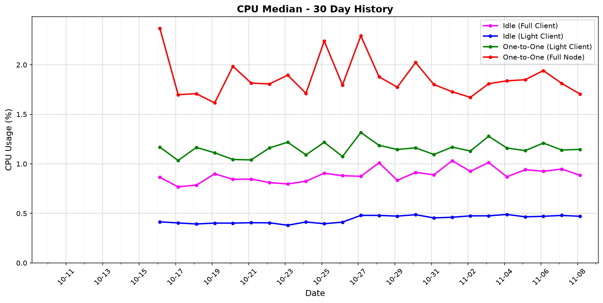
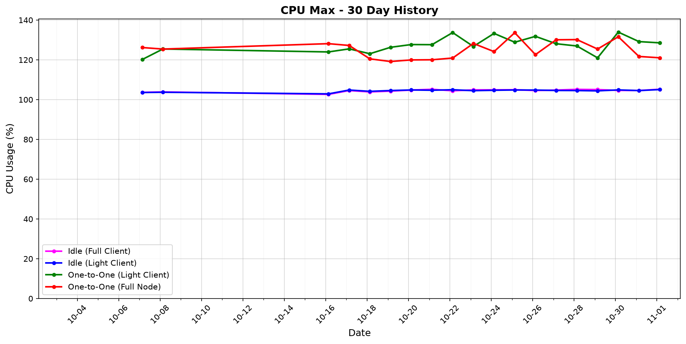
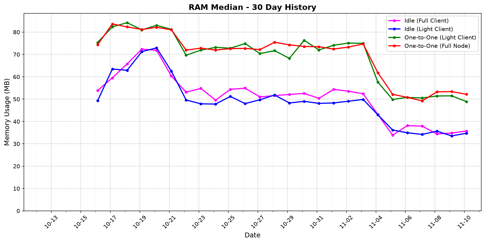
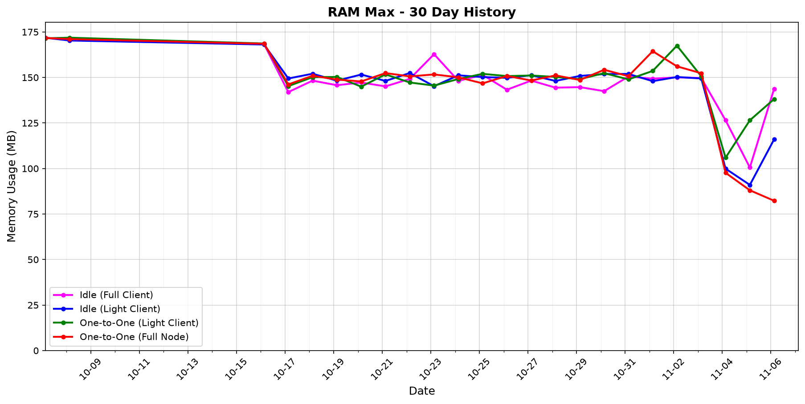
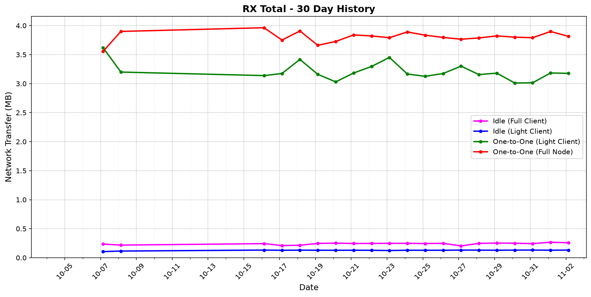
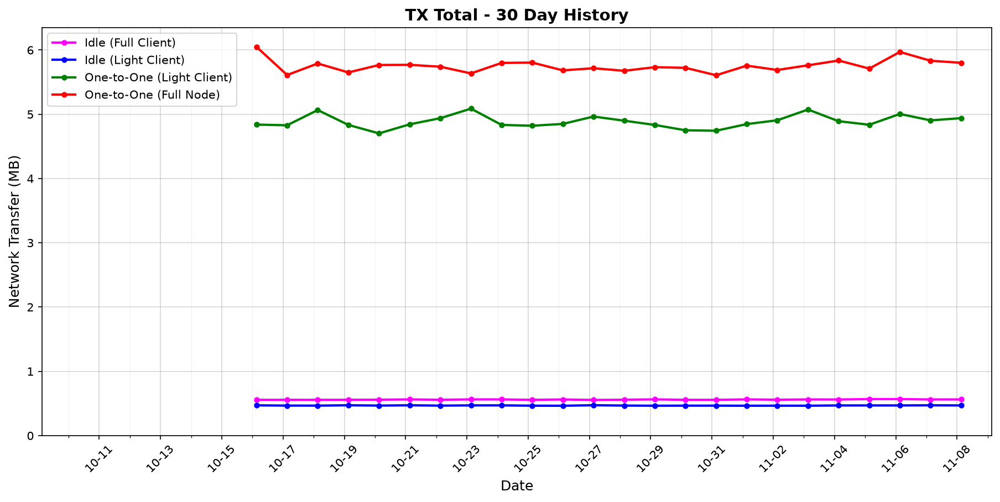
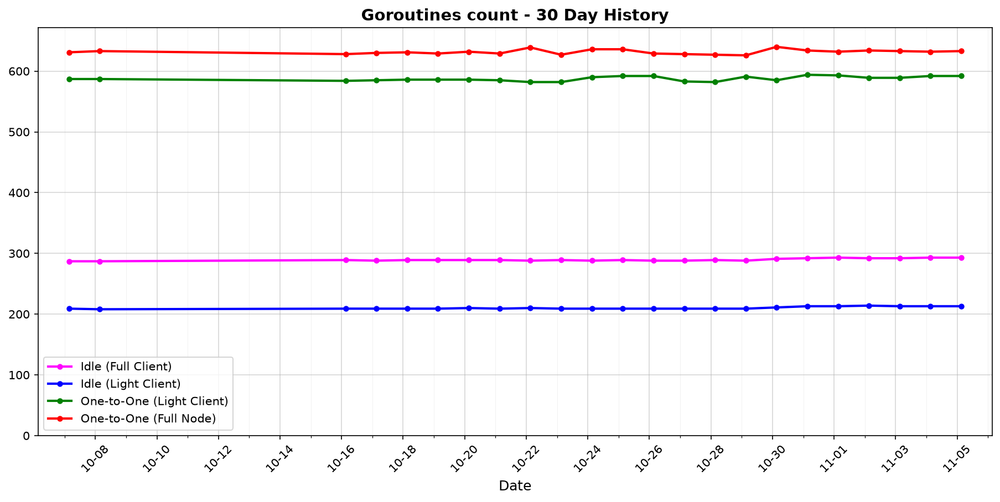
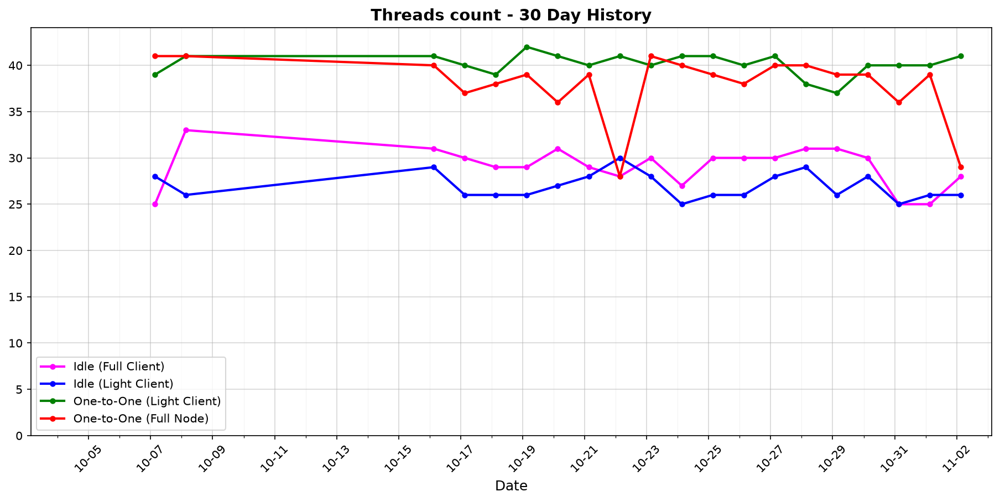

# status-go-benchmarks

Benchmark metrics with 30-day history and latest comparison.

## 30-Day History

| Metric History                                                     | Metric History                                               |
|--------------------------------------------------------------------|--------------------------------------------------------------|
|              |              |
|              |              |
|                  |            |
|  |  |

## Latest Report (2026-11-07)

| Run       | Date       | Time     | Commit      |
|-----------|------------|----------|-------------|
| Contender | 2026-11-07 | 03:12:57 | `55382ae48` |
| Baseline  | 2026-11-06 | 03:10:30 | `a946e6d9e` |

| Metric                | test_idle [waku_light_client_False]                                                                                             | test_idle [waku_light_client_True]                                                                                            | test_one_to_one_messages [waku_light_client_True]                                                                                                           | test_one_to_one_messages [waku_light_client_False]                                                                                                            |
|-----------------------|------------------------------------------------------------------------------------------------------------------------------------|----------------------------------------------------------------------------------------------------------------------------------|----------------------------------------------------------------------------------------------------------------------------------------------------------------|------------------------------------------------------------------------------------------------------------------------------------------------------------------|
| CPU Median            | 0.95% (+2.5%)                                                                                                                      | 0.48% (+2.0%)                                                                                                                    | 1.14% (-5.8%)                                                                                                                                                  | 1.81% (-6.7%)                                                                                                                                                    |
| CPU Max               | 104.33% (-0.5%)                                                                                                                    | 104.98% (+0.7%)                                                                                                                  | 139.75% (+2.7%)                                                                                                                                                | 123.57% (-7.1%)                                                                                                                                                  |
| RAM Median            | 37.91 MB (-0.7%)                                                                                                                   | 34.21 MB (-2.1%)                                                                                                                 | 50.50 MB (-0.6%)                                                                                                                                               | 49.23 MB (-3.1%)                                                                                                                                                 |
| RAM Max               | 124.36 MB (-13.5%)                                                                                                                 | 112.34 MB (-3.2%)                                                                                                                | 124.42 MB (-9.9%)                                                                                                                                              | 81.98 MB (-0.4%)                                                                                                                                                 |
| RX Total              | 254.2 KB (-7.2%)                                                                                                                   | 127.5 KB (-3.8%)                                                                                                                 | 3.19 MB (-3.5%)                                                                                                                                                | 3.86 MB (-0.6%)                                                                                                                                                  |
| TX Total              | 576.1 KB (-1.1%)                                                                                                                   | 483.0 KB (+0.4%)                                                                                                                 | 4.91 MB (-2.0%)                                                                                                                                                | 5.83 MB (-2.3%)                                                                                                                                                  |
| Goroutines count      | 293 (0%)                                                                                                                           | 213 (0%)                                                                                                                         | 591 (+0.5%)                                                                                                                                                    | 633 (+0.2%)                                                                                                                                                      |
| Threads count         | 26 (-10.3%)                                                                                                                        | 27 (+8.0%)                                                                                                                       | 41 (0%)                                                                                                                                                        | 39 (0%)                                                                                                                                                          |
| **Performance Chart** | ![test_idle[waku_light_client_False]](benchmarks/20261107T031257_55382ae48/test_idle[wakuV2LightClient_False]-20261107-030034.png) | ![test_idle[waku_light_client_True]](benchmarks/20261107T031257_55382ae48/test_idle[wakuV2LightClient_True]-20261107-030206.png) | ![test_one_to_one_messages[waku_light_client_True]](benchmarks/20261107T031257_55382ae48/test_one_to_one_messages[wakuV2LightClient_True]-20261107-030733.png) | ![test_one_to_one_messages[waku_light_client_False]](benchmarks/20261107T031257_55382ae48/test_one_to_one_messages[wakuV2LightClient_False]-20261107-030450.png) |
