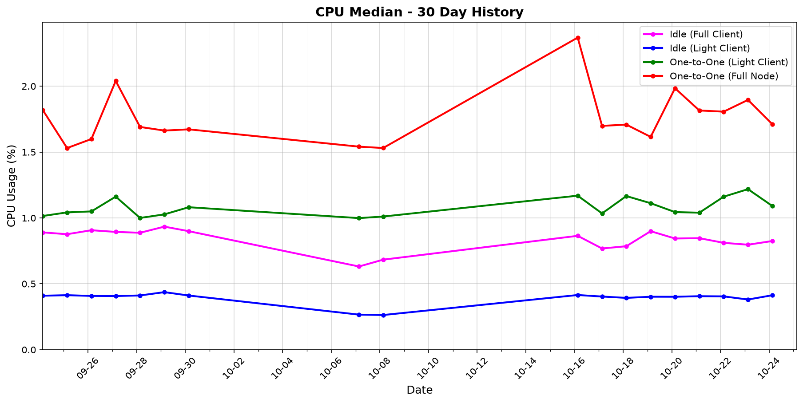
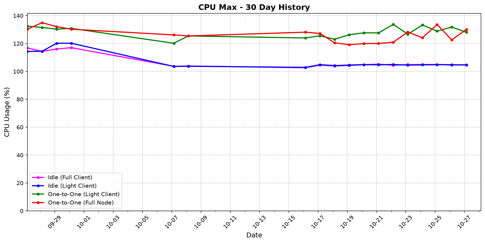
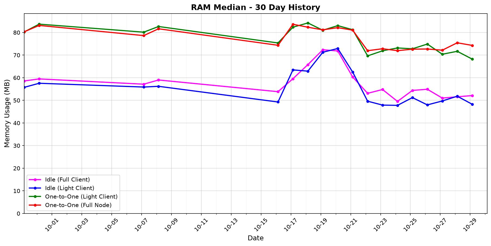
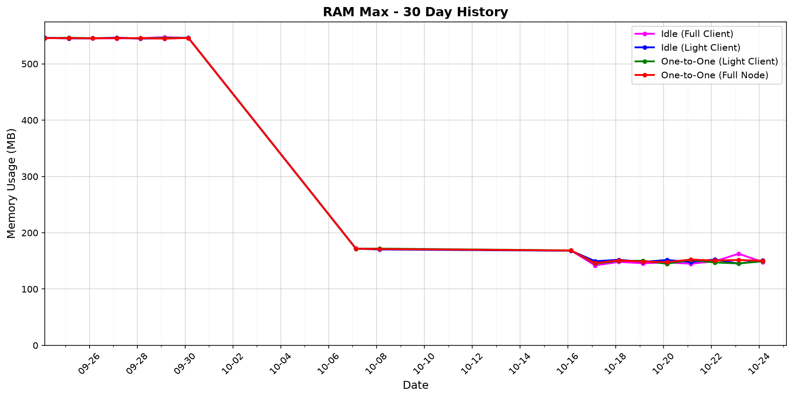
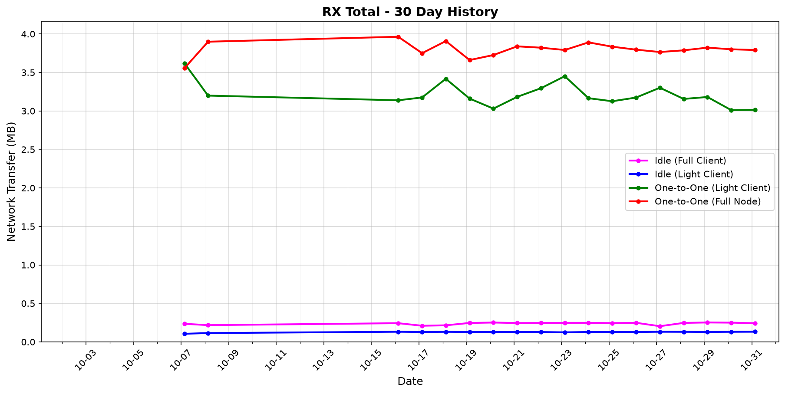
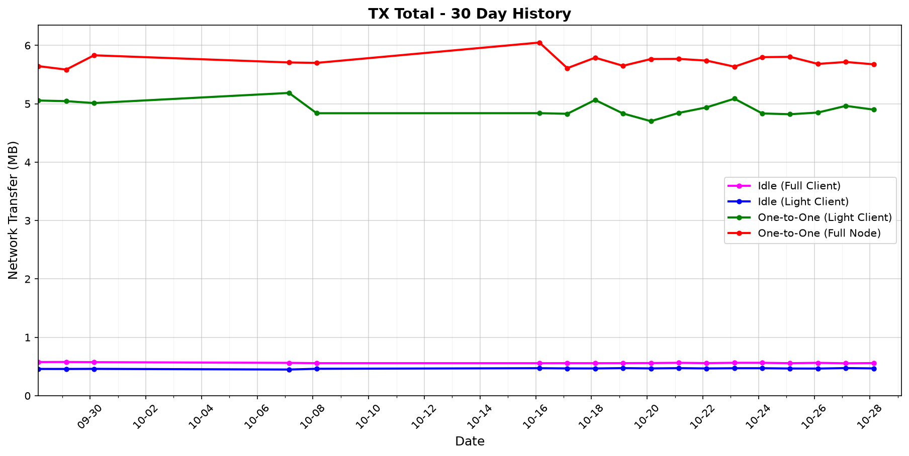
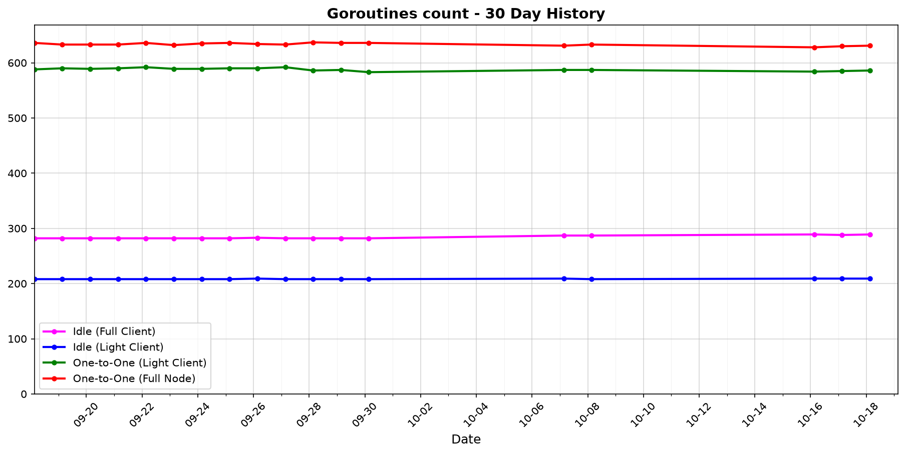
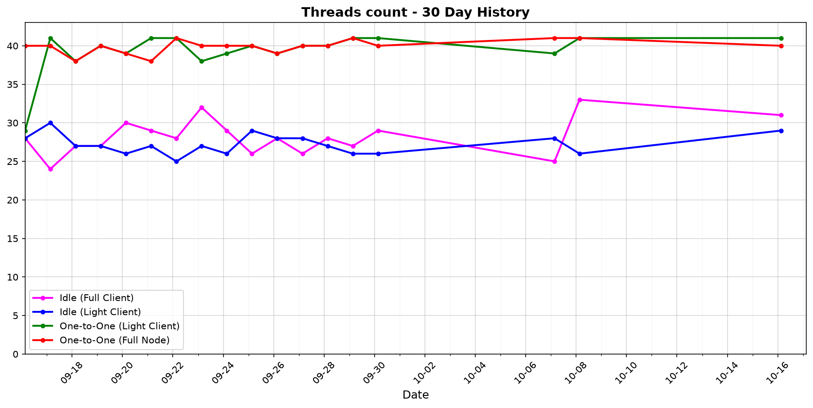

# status-go-benchmarks

Benchmark metrics with 30-day history and latest comparison.

## 30-Day History

| Metric History                                                     | Metric History                                               |
|--------------------------------------------------------------------|--------------------------------------------------------------|
|              |              |
|              |              |
|                  |            |
|  |  |

## Latest Report (2026-10-31)

| Run       | Date       | Time     | Commit      |
|-----------|------------|----------|-------------|
| Contender | 2026-10-31 | 03:13:15 | `29166d214` |
| Baseline  | 2026-10-30 | 03:13:47 | `12c6e3f6c` |

| Metric                | test_idle [waku_light_client_False]                                                                                             | test_idle [waku_light_client_True]                                                                                            | test_one_to_one_messages [waku_light_client_True]                                                                                                           | test_one_to_one_messages [waku_light_client_False]                                                                                                            |
|-----------------------|------------------------------------------------------------------------------------------------------------------------------------|----------------------------------------------------------------------------------------------------------------------------------|----------------------------------------------------------------------------------------------------------------------------------------------------------------|------------------------------------------------------------------------------------------------------------------------------------------------------------------|
| CPU Median            | 0.89% (-2.8%)                                                                                                                      | 0.45% (-6.6%)                                                                                                                    | 1.09% (-5.8%)                                                                                                                                                  | 1.80% (-11.0%)                                                                                                                                                   |
| CPU Max               | 104.58% (-0.1%)                                                                                                                    | 104.55% (-0.3%)                                                                                                                  | 129.17% (-3.6%)                                                                                                                                                | 121.70% (-7.5%)                                                                                                                                                  |
| RAM Median            | 50.37 MB (-4.2%)                                                                                                                   | 48.10 MB (-1.9%)                                                                                                                 | 72.02 MB (-5.6%)                                                                                                                                               | 73.46 MB (-0.2%)                                                                                                                                                 |
| RAM Max               | 150.51 MB (+5.6%)                                                                                                                  | 151.96 MB (+0.0%)                                                                                                                | 148.93 MB (-2.3%)                                                                                                                                              | 150.71 MB (-2.3%)                                                                                                                                                |
| RX Total              | 248.7 KB (-2.9%)                                                                                                                   | 135.3 KB (+0.7%)                                                                                                                 | 3.01 MB (+0.1%)                                                                                                                                                | 3.79 MB (-0.2%)                                                                                                                                                  |
| TX Total              | 570.4 KB (-0.0%)                                                                                                                   | 477.4 KB (+0.0%)                                                                                                                 | 4.74 MB (-0.1%)                                                                                                                                                | 5.61 MB (-2.0%)                                                                                                                                                  |
| Goroutines count      | 292 (+0.3%)                                                                                                                        | 213 (+0.9%)                                                                                                                      | 594 (+1.5%)                                                                                                                                                    | 634 (-0.9%)                                                                                                                                                      |
| Threads count         | 25 (-16.7%)                                                                                                                        | 25 (-10.7%)                                                                                                                      | 40 (0%)                                                                                                                                                        | 36 (-7.7%)                                                                                                                                                       |
| **Performance Chart** | ![test_idle[waku_light_client_False]](benchmarks/20261031T031315_29166d214/test_idle[wakuV2LightClient_False]-20261031-030038.png) | ![test_idle[waku_light_client_True]](benchmarks/20261031T031315_29166d214/test_idle[wakuV2LightClient_True]-20261031-030210.png) | ![test_one_to_one_messages[waku_light_client_True]](benchmarks/20261031T031315_29166d214/test_one_to_one_messages[wakuV2LightClient_True]-20261031-030740.png) | ![test_one_to_one_messages[waku_light_client_False]](benchmarks/20261031T031315_29166d214/test_one_to_one_messages[wakuV2LightClient_False]-20261031-030454.png) |
